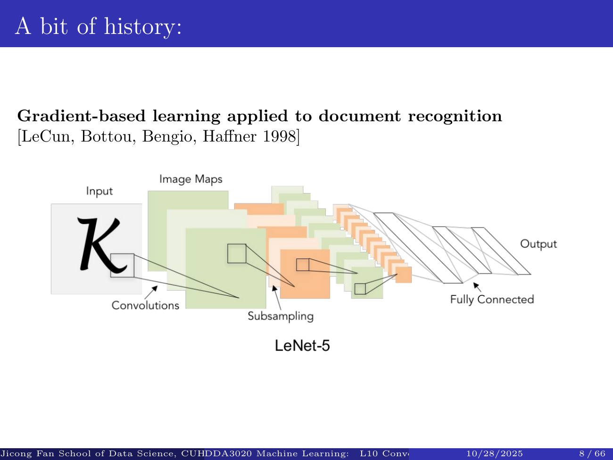
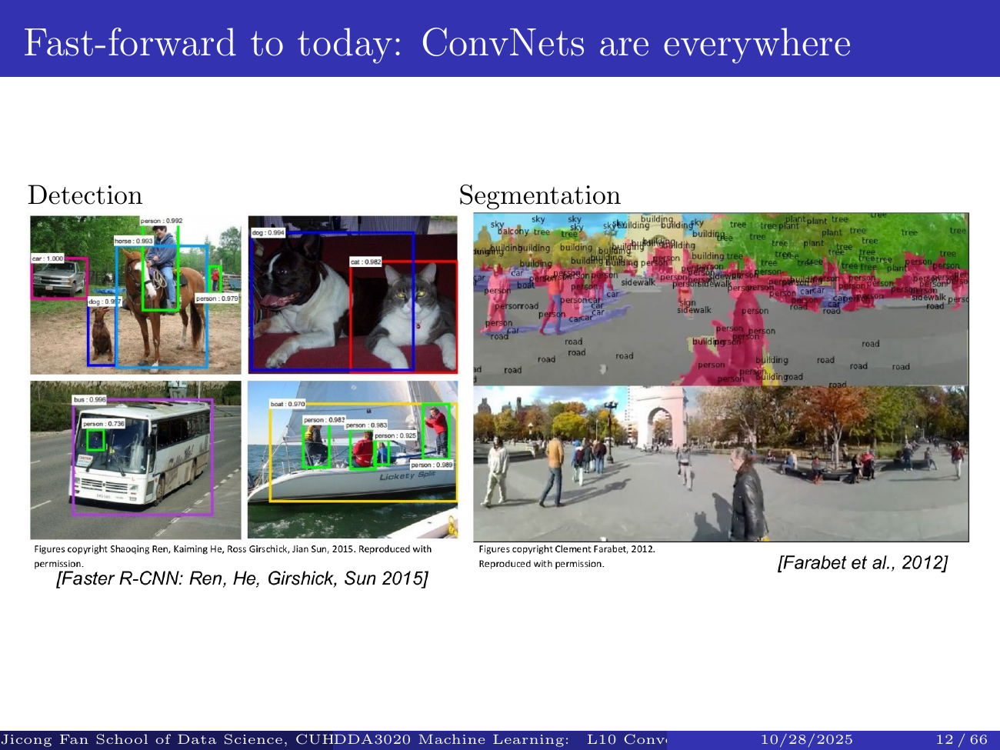

# DDA3020 L10: Convolutional Neural Networks

Complete study materials for the supplied Jicong Fan 2025 lecture, with full narrated parts, mathematical explanations and executable labs. These materials are not the new semester's official course announcement. PDF page references identify sources; new worked calculations are teaching examples. The original slides remain unchanged.

**Learning objectives:** History, applications and task structure; Local filters and channel depth; Stride, padding and valid boundaries; Tensor dimensions and parameter sharing; Convolution forward and backward computation; Pooling and backward routing; Receptive fields and downsampling; Fully connected heads and complete architecture design; Architecture tradeoffs and further implementation.

## Why convolution: history, tasks and local filters

Part 1 of 3. Follow the source lecture, then verify the computation.

### Watch the full part

<div class="card video" data-video="../videos/L10-1.mp4"></div>

### A short history with a practical question

Welcome to Lecture Ten. Last lecture, a dense network learned features by connecting all input coordinates to hidden units. For a thirty two by thirty two color image, that means three thousand and seventy two input values. Convolution keeps the image's spatial arrangement and uses small shared filters. Our goal is to understand what those filters compute, how the output dimensions are determined, and how convolution, activation, pooling and dense layers fit together.

```text
Dense: flatten all pixels
CNN: preserve local structure
```

The lecture's history begins with adaptive linear models around nineteen sixty and the later popularization of backpropagation in nineteen eighty six. The early convolutional document-recognition network demonstrated gradient-based learning, with the influential nineteen ninety eight paper connecting convolutional feature maps and subsampling to a classifier. These historical examples show that convolution is an architectural idea with a long development, rather than a technique that appeared suddenly with today's language models. The dates identify the slide's milestones, not exclusive invention claims.

```text
1960: adaptive linear models
1986: backpropagation popularized
1998: LeNet document recognition
```

The two thousand six deep-learning revival and AlexNet's two thousand twelve ImageNet result helped demonstrate the potential of learned hierarchical representations at larger scale. Data, computational resources and training methods mattered alongside architecture. Do not infer that every deeper network automatically generalizes better. Instead, ask what structure the model exploits. Images have local patterns that recur at many positions, making locality and shared weights useful assumptions. This is the thread connecting the historical examples to the calculation we will perform.

```text
2006: deep-learning revival
2012: AlexNet on ImageNet
Architecture + data + computation
```



**Source:** L10 PDF pp. 1, 10.

### Different visual tasks require different outputs

The application gallery begins with classification and retrieval. Classification might identify the main object in an image. Retrieval maps an image to a representation used to find related images. These are related but distinct outputs. Detection must locate objects and assign labels to them. Segmentation produces a label at each pixel or region. A backbone that extracts features can support several tasks, but the final prediction head and training loss must match what the task requires.

```text
Classification: one image label
Retrieval: related images
```

The next examples include driving scenes, video processing and estimation of human joint locations. Video brings a time dimension in addition to spatial dimensions. A pose system predicts structured locations such as joints rather than only a single category. The hardware picture in the historical slides illustrates the importance of accelerated computation; specific product names are examples from those materials. We do not need that exact hardware to understand the mathematical operation or reproduce a tiny example.

```text
Detection: boxes + labels
Segmentation: labels per pixel
```

The gallery also includes medical and scientific imagery, traffic signs, galaxies, whales and aerial images. Image captioning turns an image representation into a sequence of words, connecting this lecture to the next. Its illustrated captions include mistakes, reminding us that plausible predictions can still misdescribe a scene. Visualization and synthesis examples show other uses of learned features. Across all these applications, distinguish the shared feature extractor from the task-specific output, and evaluate predictions against the actual task rather than appearance alone.

```text
Video, pose, science, captions
Output structure determines the head
Predictions can still be wrong
```



**Source:** L10 PDF pp. 11, 19.

### A network is a sequence of volumes

The preview diagrams describe a convolutional network as a sequence of three-dimensional activation volumes. Width and height describe spatial positions; the third dimension counts channels. For an RGB image, there are three input channels. Later channels are learned feature maps and do not necessarily correspond to colors. Convolution changes the volume using learned filters. An elementwise ReLU changes values but leaves the tensor's shape unchanged. Pooling can reduce spatial dimensions without mixing the channels.

```text
32 x 32 x 3 -> CONV -> ReLU
Spatial dimensions + channels
```

Follow the first preview example. Start with a thirty two by thirty two image with three channels. Six filters, each five by five across all three input channels, with stride one and no padding, produce a twenty eight by twenty eight output with six channels. Each filter contributes one channel, not three. A second layer must therefore accept six input channels. Its filters have a different depth even if their spatial width remains five.

```text
6 filters, 5 x 5, no padding
32 x 32 x 3 -> 28 x 28 x 6
```

Ten filters in that second layer produce twenty four by twenty four by ten activations. You can see the spatial shrinking before we derive a general formula. Stacking such layers grows the receptive field in the original image. The feature-map visualizations in the slides relate one filter to one activation map. They are illustrations of learned responses, not proof that every filter has a single human-interpretable meaning. Track the dimensions at every arrow, because a mismatched channel count makes a network specification invalid.

```text
10 filters, 5 x 5, no padding
28 x 28 x 6 -> 24 x 24 x 10
```

**Source:** L10 PDF pp. 20, 27.

### One filter computes one dot product

A convolutional filter spans a small spatial window and, for the ordinary dense convolution considered here, all input channels. At one position, multiply each patch value by its corresponding filter weight, add the products and add one bias. The result is one number. A five by five filter on a three-channel image therefore performs a seventy-five-dimensional dot product. It does not produce a separate output number for each input channel; those channel contributions are summed.

```text
Input patch: F x F x C
Multiply each entry by its weight
Sum + one bias
```

Move the filter to the next position and repeat the same calculation with the same learned numbers. The input patch changes, but the filter does not gain new parameters when it moves. This is spatial parameter sharing. The progressive diagrams in the lecture trace several outputs becoming one activation map. CNN libraries normally implement cross-correlation, where the kernel is not reversed. We retain the conventional name convolution while being explicit about the operation in our executable example.

```text
5 x 5 x 3 = 75 weights
One location -> one number
Reuse at every valid position
```

A second filter has its own weights and produces another activation map. Stack all the maps along the output channel dimension. Six filters produce six channels; ten filters produce ten. A conventional filter's channel depth equals the current input depth, not the number of filters we have chosen. Depthwise and grouped convolutions are useful exceptions with different connectivity, beyond the basic layer in these slides. The general principle remains that output shape and learned-parameter count answer different questions.

```text
K filters -> K output maps
Shared spatially within a filter
Different weights between filters
```

<div class="card demo" data-demo="convolution"><div class="head">Investigate the computation</div><div class="demo-body"></div></div>

**Source:** L10 PDF pp. 28, 37.

### Predict the channel count

**Predict before revealing the answer.**

Pause and predict the output channel count for an RGB input processed by six ordinary convolutional filters. Is it three, six or eighteen? Explain exactly where the input-channel contributions are combined. Then consider the next layer: if it uses ten filters, what input depth must each of those filters span? Use the volume diagram rather than multiplying every number you see in the architecture description.

<details><summary>Show the explanation</summary>

The first output depth is six. Each filter sums across its three input channels at a spatial location and produces one output value there. Six filters therefore produce six maps. The next layer's filters must each span the six channels arriving from that first layer. Ten such filters produce ten new channels. Your exercise is to label every filter's full three-dimensional shape in the two-layer preview, including the channel depth as well as its spatial size.

</details>

Three ideas summarize this part. Convolution applies local dot products to preserve spatial structure. One filter reuses its parameters across locations. A bank of filters produces a bank of output feature maps. The application gallery showed why the final output also depends on the task. Next, we derive the spatial formula, investigate strides and padding, and reproduce the lecture's example with exactly seven hundred and sixty trainable parameters.

**Source:** L10 PDF pp. 22, 37.

## Stride, padding, shapes and parameter counts

Part 2 of 3. Follow the source lecture, then verify the computation.

### Watch the full part

<div class="card video" data-video="../videos/L10-2.mp4"></div>

### Derive the spatial formula from valid starts

To determine the output width, count valid window starting positions. For an input of width seven and a filter of width three, with no padding and stride one, a zero-indexed window can start at zero through four. That gives five output positions. The same reasoning applies to height, so a square input produces a five by five map. This derivation is safer than memorizing a formula without understanding what each term counts.

```text
N=7, F=3, S=1, P=0
Valid starts: 0,1,2,3,4
Output width = 5
```

Stride is the distance between successive window starts. At stride two, starts zero, two and four fit, giving three outputs per axis. At stride three, starts zero and three fit, giving two. A start at six would overrun the image. The lecture describes this last setting as not fitting exactly and shows a fractional expression. In standard valid convolution, we keep the complete windows and skip the remaining border, so the size is the floor of that expression.

```text
S=2: starts 0,2,4 -> 3
S=3: starts 0,3 -> 2
```

The general formula is the floor of input size plus twice symmetric padding minus filter size, divided by stride, then plus one. It assumes dilation one and a padded input large enough for at least one window. Width and height are computed separately. Some APIs called same padding choose asymmetric padding for certain strides, so use their documented convention rather than assuming it matches this symmetric-padding formula. Our calculator follows the explicit symmetric convention in the lecture.

```text
Nout=floor((N+2P-F)/S)+1
Complete windows only
Apply independently to W and H
```

<div class="card demo" data-demo="shape"><div class="head">Investigate the computation</div><div class="demo-body"></div></div>

**Source:** L10 PDF pp. 38, 48.

### Padding keeps useful border positions

Without padding, each convolution can shrink the activation map because the filter must remain entirely within the image. Padding adds values around the border, commonly zeros. With padding one, a seven-wide input becomes a nine-wide padded array. A three-wide filter at stride one then has seven valid starts, preserving the original spatial size. The border outputs combine real values with inserted zeros, so they do not have exactly the same information as interior outputs.

```text
Zero padding P adds P cells
to both ends of each axis
```

For an odd filter width at stride one, padding half of the filter width minus one preserves the width. A three-wide filter needs padding one, a five-wide filter needs padding two, and a seven-wide filter needs padding three. The lecture uses these settings as common examples. This rule preserves tensor dimensions; it does not reverse the filter's smoothing or feature-detection effect, and it does not imply that every input pixel contributes equally to the result.

```text
N=7, F=3, S=1, P=1
Nout = 7
```

Padding is a hyperparameter choice, not a trainable weight. It changes which patches the layer visits and can affect boundary behavior. Symmetric zero padding also differs from reflecting or repeating border values. When implementing the layer, ensure the forward pass and its gradient use the same convention. In an architecture table, record input size, filter width, stride and padding together. Saying only that a layer uses a three by three kernel is insufficient to determine its output dimensions.

```text
Odd F, stride 1:
P=(F-1)/2 preserves size
F=5 -> P=2
```

**Source:** L10 PDF pp. 49, 51.

### Reproduce the 760-parameter example

Now reproduce the lecture's numerical example. The input is thirty two by thirty two by three. We have ten filters with spatial size five by five, stride one and padding two. Each filter spans all three input channels. First calculate the spatial dimensions. Thirty two plus four minus five gives thirty one, divide by one and add one to obtain thirty two. Ten filters supply the output depth, so the activation volume is thirty two by thirty two by ten.

```text
Input 32 x 32 x 3
K=10, F=5, S=1, P=2
```

Count the learned numbers separately. One filter has five times five times three weights, which is seventy five. Under our convention it also has one bias, giving seventy six parameters. Ten filters give seven hundred and sixty trainable parameters. The output contains ten thousand two hundred and forty activations for one image. Reusing the filter across those positions creates more activations, not more parameters. Confusing these counts hides the main efficiency gained by weight sharing.

```text
Nout = floor((32+4-5)/1)+1
     = 32
Output: 32 x 32 x 10
```

If we change only the stride to two, spatial size becomes sixteen while the filter bank remains unchanged. The output is sixteen by sixteen by ten, still using seven hundred and sixty parameters. If we change only the number of filters to twenty, depth doubles and parameter count doubles. If the input channel count changes, each ordinary filter's weight count changes too. Always identify which architectural quantity was changed before deciding what stays constant.

```text
Weights per filter = 5*5*3 = 75
Parameters = (75+1)*10 = 760
Activations = 10240
```

<div class="card demo" data-demo="shape"><div class="head">Investigate the computation</div><div class="demo-body"></div></div>

**Source:** L10 PDF pp. 52, 56.

### An executable filter and its backward pass

Our executable example makes the dot product visible. A five by five single-channel image contains a small repeated cross-like pattern. With an all-one three by three filter, zero bias, no padding and stride one, the first patch sums to four. The next sums to five. The complete three by three result has center value seven, edge-center values five and corner values four. These are newly constructed teaching numbers, not values copied from a slide image.

```text
Toy patch sums, all-one 3 x 3 kernel
Output [[4,5,4],[5,7,5],[4,5,4]]
```

Backpropagation through convolution reuses the same path-summing rule from Lecture Nine. One filter weight is used at many spatial positions. Its gradient adds the upstream sensitivity at every output position, multiplied by the corresponding input value. The bias gradient sums those upstream sensitivities. Input gradients also receive contributions from overlapping windows. They must be accumulated, not overwritten. The optional implementation exercise checks a filter-weight gradient against a central finite difference.

```text
dL/dK[i,j] = sum over positions
  upstream[r,c] * input[r+i,c+j]
```

Although the slides focus on forward computation, this derivative explains how a filter becomes learned rather than hand-designed. A filter filled with ones is useful for understanding the arithmetic, not a claim that trained networks keep such weights. During training the objective supplies upstream gradients, and the optimizer changes the kernel coefficients. The website's stepper shows individual patches, while the checked Python implementation reproduces the entire output and verifies the shared-weight gradient numerically.

```text
One shared weight, many uses
Accumulate all contributions
Bias gradient = sum upstream
```

**Source:** L10 PDF pp. 30, 57.

### Predict a non-divisible stride

**Predict before revealing the answer.**

Pause and calculate a new case without first using the formula. An input has width eight, the filter width is three, stride is two and padding is zero. List each valid zero-indexed starting position and determine the output width. Then count the parameters for four such filters on a two-channel input, including one bias per filter. The shape calculation and parameter calculation should use different subsets of these numbers.

<details><summary>Show the explanation</summary>

The valid starts are zero, two and four, so output width is three. Starting at six would require an input value beyond the last index, seven. The formula gives the floor of five divided by two, plus one, also three. Each filter has three times three times two weights plus one bias, giving nineteen parameters, and four filters give seventy six. The non-divisible stride changes the positions used, not the number of coefficients inside each filter.

</details>

Remember three distinctions. Output size counts complete sliding windows. Padding changes the domain over which those windows are placed. Parameter count describes the filter bank and its biases. For practice, use the interactive calculator to vary exactly one setting at a time, then explain each resulting change before looking at the number. Next, we combine pooling, a dense prediction head and the preceding convolution rules into a complete small image classifier.

**Source:** L10 PDF pp. 38, 57.

## Pooling, receptive fields and a complete CNN

Part 3 of 3. Follow the source lecture, then verify the computation.

### Watch the full part

<div class="card video" data-video="../videos/L10-3.mp4"></div>

### Max pooling on the slide's actual grid

Pooling reduces spatial size by summarizing a region. In max pooling, each output is the largest value in its input patch. The slide uses two by two windows and stride two. Its four by four input has first rows one, one, two, four and five, six, seven, eight. The lower rows are three, two, one, zero and one, two, three, four. Split this into four non-overlapping patches and calculate each maximum independently.

```text
2 x 2 window, stride 2
Each channel processed separately
```

The upper-left patch gives six, the upper-right gives eight, the lower-left gives three, and the lower-right gives four. Therefore the pooled output is the two by two matrix with rows six, eight and three, four. Pooling operates separately within every channel, preserving the channel count. A two hundred twenty four by two hundred twenty four by sixty four volume becomes one hundred twelve by one hundred twelve by sixty four under this two by two, stride-two configuration.

```text
Slide input:
[1 1 | 2 4]
[5 6 | 7 8]
[3 2 | 1 0]
[1 2 | 3 4]
```

Max pooling has no learned filter weights or biases. During backpropagation, sensitivity flows to an input that attained the maximum; ties require an implementation convention. Overlapping windows can contribute gradients to the same input and those contributions add. Pooling can improve robustness to small local shifts but does not make the entire network invariant to every translation. It discards spatial detail, which can be harmful for tasks requiring precise locations. Downsampling is a design tradeoff, not automatically an improvement.

```text
Output [[6,8],[3,4]]
No trainable weights or biases
Store argmax for backward routing
```

<div class="card demo" data-demo="slidePooling"><div class="head">Investigate the computation</div><div class="demo-body"></div></div>

**Source:** L10 PDF pp. 58, 62.

### Track receptive fields and spacing

The lecture motivates pooling by observing that repeated convolution can either shrink a volume too slowly or remove useful detail too quickly. To reason about what a later unit sees, track two quantities. The receptive field is the span of original input positions that can affect it. The effective spacing is how far neighboring current features are apart in original-input coordinates. Both start at one for the original pixel grid.

```text
Start: receptive field r=1
Input spacing j=1
```

For a layer with filter width F and stride S, the new receptive-field width equals the old width plus F minus one times the old spacing. The new spacing equals the old spacing multiplied by the stride. Consider a three-wide, stride-one convolution: receptive field becomes three and spacing stays one. Follow with a two-wide, stride-two pooling layer: receptive field becomes four and spacing becomes two. The larger stride changes what the next layer's neighbors mean in original coordinates.

```text
r_new = r + (F-1)*j
j_new = j*S
```

Another three-wide, stride-one convolution now adds four original pixels to the receptive-field width, producing eight, while spacing stays two. This is a theoretical dependency calculation for interior positions. It does not measure how strongly every pixel affects the output, and padding can make boundary regions include artificial values. The website exposes this recurrence step by step. Your exercise is to compare two three-wide stride-one convolutions without pooling: their receptive field is five, not six.

```text
CONV3 -> r=3, j=1
POOL2/S2 -> r=4, j=2
CONV3 -> r=8, j=2
```

<div class="card demo" data-demo="receptive"><div class="head">Investigate the computation</div><div class="demo-body"></div></div>

**Source:** L10 PDF pp. 24, 59, 62.

### The fully connected prediction head

A fully connected layer looks at the entire input volume rather than only a local window. Flattening arranges the width, height and channel values into a single vector. It does not learn weights or change the values. If the vector length is D and the dense layer has M outputs, there are D times M weights plus M biases. For the slide's thirty two by thirty two by three image and ten outputs, that gives thirty thousand seven hundred and thirty parameters.

```text
Flatten W x H x C -> D=W*H*C
Values rearranged, not recomputed
```

In an early CNN architecture, convolution and pooling first construct a representation, then a dense head uses all its entries to predict class scores. Those scores are often called logits. Softmax turns logits into a probability distribution, and a suitable cross-entropy loss compares that distribution with a target class. Softmax alone does not make the model correct or calibrated. The loss and training data still determine how the parameters are learned.

```text
Dense D -> M
Weights D*M, biases M
32*32*3 -> 10: 30730 params
```

A classifier is only one possible head. Detection requires localization as well as labels, segmentation requires a label at each pixel, and captioning produces a sequence. Some modern classifiers replace a large flattened dense head with global average pooling and a smaller linear layer. This is a useful extension rather than a requirement of the original slides. Whenever you change the head, recalculate both dimensions and parameters instead of assuming the backbone determines the complete model.

```text
Classifier head matches the task
Logits -> softmax -> cross entropy
Other tasks need other outputs
```

**Source:** L10 PDF pp. 63, 65.

### An end-to-end architecture audit

Here is a new complete architecture that uses all the lecture's building blocks. Start with a thirty two by thirty two by three image. A three by three convolution with eight filters, stride one and padding one preserves spatial size. Its parameter count is three times three times three plus one, all multiplied by eight, giving two hundred twenty four. ReLU preserves the shape. Two by two pooling with stride two produces sixteen by sixteen by eight.

```text
32x32x3 -> CONV3/P1/K8
32x32x8, parameters 224
ReLU -> POOL2/S2 -> 16x16x8
```

A second three by three convolution has sixteen filters and input depth eight, again using stride one and padding one. It produces sixteen by sixteen by sixteen activations. Its parameter count is seventy three times sixteen, or one thousand one hundred and sixty eight. After ReLU and another two by two stride-two pool, the volume is eight by eight by sixteen. Flattening gives one thousand and twenty four values, with no new parameters introduced by flattening.

```text
CONV3/P1/K16 -> 16x16x16
Parameters 1168
POOL2/S2 -> 8x8x16
```

A ten-output dense head then has ten thousand two hundred and fifty parameters. Adding the two convolution layers gives a total of eleven thousand six hundred and forty two learned numbers. Most are in the dense head in this example. This audit is deliberately explicit: list every tensor, then count each learned operator once. The checked implementation verifies the table. The lecture's further-reading slide points to the Stanford computer-vision course and frameworks such as PyTorch and TensorFlow for larger implementations.

```text
Flatten 1024 -> Dense10
Parameters 10250
Total = 11642
```

<div class="card demo" data-demo="architecture"><div class="head">Investigate the computation</div><div class="demo-body"></div></div>

**Source:** L10 PDF pp. 22, 25, 56, 66.

### Lecture Ten consolidation

**Predict before revealing the answer.**

Pause for a final architecture question. In our complete CNN, replace flattening and the one-thousand-and-twenty-four-input dense head with global average pooling over each of the sixteen final channels, followed by a ten-output dense layer. What changes in parameter count? Does the new head preserve all the location information from the eight by eight spatial grid? Separate the arithmetic question from the modeling tradeoff before checking the answer.

<details><summary>Show the explanation</summary>

Global averaging supplies sixteen numbers, so the dense layer now has sixteen times ten weights plus ten biases, or one hundred and seventy parameters. The full network total becomes one thousand five hundred and sixty two. The head has fewer coefficients but discards the detailed arrangement of the final spatial positions. This can be useful for classification and inappropriate for some location-sensitive tasks. Your exercise is to change the stride of one convolution, then recalculate the shape at every following stage, the flattened length and the parameter counts.

</details>

The lecture connects three ideas. Local shared filters efficiently compute spatial features. Explicit shape and parameter calculations prevent architectural mistakes. Pooling and a task-appropriate prediction head turn those features into an output. You have followed the historical motivation, applications, convolution arithmetic, padding and stride, pooling, dense layers and an end-to-end design. Next we replace spatial neighborhoods with ordered sequences and examine recurrent state, gated memory and attention.

**Source:** L10 PDF pp. 1, 66.

## Summary, exercises and executable labs

Check every learning objective with an exercise, then verify the reference implementation.

### Self-check

<div class="card demo" data-demo="quiz"><div class="head">Check your understanding</div><div class="demo-body"></div></div>

### Exercises and worked solutions

**1. Explain — History, applications and task structure.** Distinguish classification, retrieval, detection, segmentation and image captioning. Which require spatially organized outputs?

<details><summary>Worked solution 1</summary><p>Classification predicts an image label; retrieval finds related examples; detection predicts boxes and labels; segmentation predicts pixel/region labels; captioning produces a word sequence. Detection and segmentation explicitly require spatial localization.</p></details>

**2. Trace — Local filters and channel depth.** For a 32x32x3 input and six 5x5 filters, stride 1 and no padding, state filter shape and output shape.

<details><summary>Worked solution 2</summary><p>Each filter is 5x5x3. The output is 28x28x6. Channels are summed within one filter response, not concatenated into 18 output channels.</p></details>

**3. Trace — Stride, padding and valid boundaries.** Count valid starts for N=8,F=3,S=2,P=0. Compare with the non-divisible-stride example on p.48.

<details><summary>Worked solution 3</summary><p>Starts 0,2,4 fit, giving width 3. Standard valid convolution floors the size expression and skips an incomplete final window; it does not produce a fractional tensor dimension.</p></details>

**4. Derive — Tensor dimensions and parameter sharing.** Reproduce output and parameter counts for the slide's 32x32x3, K=10,F=5,S=1,P=2 example, then change only stride to 2.

<details><summary>Worked solution 4</summary><p>Output 32x32x10 and 760 parameters. Stride 2 gives 16x16x10 and still 760 parameters. Activation count and learned parameter count are distinct.</p></details>

**5. Implement — Convolution forward and backward computation.** Run the 5x5 all-one-filter example and verify a kernel gradient. Explain why gradients from spatial uses add.

<details><summary>Worked solution 5</summary><p>Output [[4,5,4],[5,7,5],[4,5,4]]. dL/dK[i,j] sums upstream[r,c]*input[r+i,c+j] over every valid position. One shared coefficient has many paths to the loss.</p></details>

**6. Trace — Pooling and backward routing.** Apply max pooling to the actual p.62 grid with 2x2 windows and stride 2.

<details><summary>Worked solution 6</summary><p>Input rows [1,1,2,4], [5,6,7,8], [3,2,1,0], [1,2,3,4] produce [[6,8],[3,4]]. Channel count is unchanged and learned parameters are zero.</p></details>

**7. Derive — Receptive fields and downsampling.** Starting with r=j=1, track receptive field r and effective spacing j through CONV3/S1, POOL2/S2, CONV3/S1.

<details><summary>Worked solution 7</summary><p>After the layers: (r,j)=(3,1),(4,2),(8,2). Use r_new=r+(F-1)*j and j_new=j*S. This is a theoretical interior receptive field.</p></details>

**8. Implement — Fully connected heads and complete architecture design.** Audit the complete CNN: CONV3/P1/K8, POOL2/S2, CONV3/P1/K16, POOL2/S2, flatten, Dense10 on 32x32x3.

<details><summary>Worked solution 8</summary><p>Shapes:32x32x8,16x16x8,16x16x16,8x8x16,1024,10. Parameter counts:224,0,1168,0,0,10250; total11642. ReLU layers preserve shapes and add no parameters.</p></details>

**9. Extend — Architecture tradeoffs and further implementation.** Replace the last flatten and Dense10 with global average pooling and Dense10. What is lost and how many parameters remain?

<details><summary>Worked solution 9</summary><p>Sixteen channel averages give a 170-parameter head. Full total1562. Detailed final spatial arrangement is discarded, a task-dependent tradeoff.</p></details>

### Run the labs

Download the [complete Python reference implementation](../labs/labs.py) and [the recorded numerical results](../labs/results.json). It requires Python 3 and NumPy. Running it checks every analytic derivative against central finite differences, trains the tiny XOR and character models with fixed seeds, and prints their final training losses. These are small educational models, not evidence of performance on unseen data.

```text
python3 labs.py
python3 labs.py --output ./lab-results
```

Gradient error must remain below 1e-7 for the supplied smooth test points. The ReLU gradient check deliberately uses positive preactivations, avoiding the nondifferentiable boundary. The convolution example verifies accumulation over shared spatial uses. The RNN implementation contains the full forward and BPTT loops rather than relying on an automatic differentiation library.

### Working with AI and further reading

Ask a tutor to identify tensor dimensions and local derivatives before suggesting code. Request a minimal counterexample for a claimed invariance or generalization guarantee. Verify every number with the reference lab and the interactive controls. Do not accept a smooth-looking training curve as proof of gradient correctness or test-set performance.

Convolution 卷积; kernel 卷积核; stride 步幅; padding 填充; feature map 特征图; pooling 池化; parameter sharing 参数共享; prediction head 预测头.

Further reading follows the original lecture references: Hornik, Stinchcombe and White (1989) on approximation; LeCun et al. (1998) on document recognition; Krizhevsky et al. (2012) on ImageNet; Hochreiter and Schmidhuber (1997) on LSTM; Cho et al. (2014) on GRU; Vaswani et al. (2017), Attention Is All You Need. These references provide context; the course calculations use the supplied decks and explicitly identified teaching examples.
