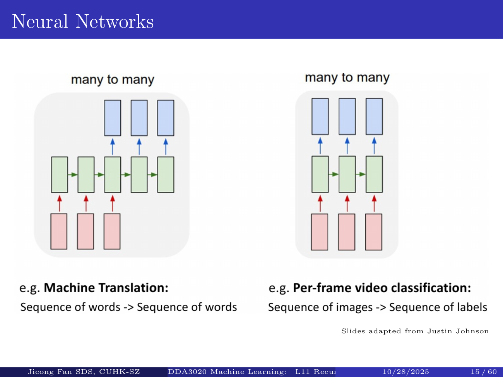
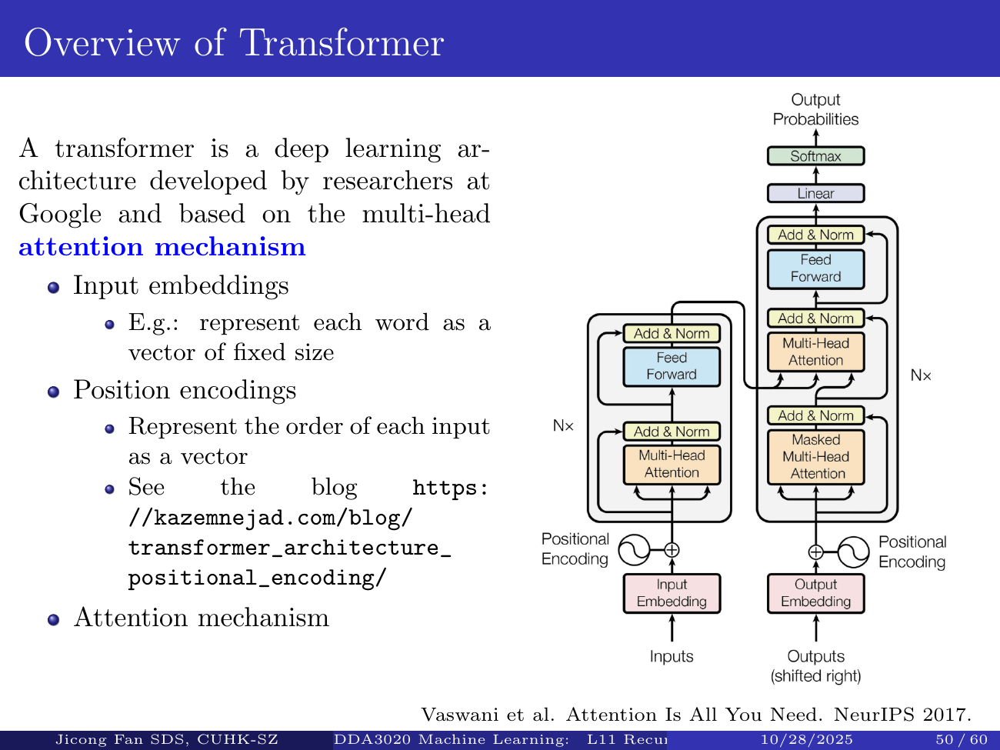

# DDA3020 L11: RNN and Transformer

Complete study materials for the supplied Jicong Fan 2025 lecture, with full narrated parts, mathematical explanations and executable labs. These materials are not the new semester's official course announcement. PDF page references identify sources; new worked calculations are teaching examples. The original slides remain unchanged.

**Learning objectives:** Sequential tasks and architecture mappings; Recurrence, unrolling and order; Character modeling and training versus generation; BPTT and computational graphs; Gradient stability and truncated BPTT; LSTM gates, cell memory and gradient routes; GRU conventions, stacked and bidirectional recurrence; Scaled attention, softmax and masking; Multi-head attention, architecture, costs and model families.

## Sequence tasks, recurrent state and language modeling

Part 1 of 3. Follow the source lecture, then verify the computation.

### Watch the full part

<div class="card video" data-video="../videos/L11-1.mp4"></div>

### The output structure of a sequence task

Welcome to Lecture Eleven. A sentence is not simply a set of words, and a time series is not a bag of measurements. Order changes meaning and predictive context. The lecture introduces time-series forecasting, speech recognition, machine translation, image captioning, video and biological sequences. These examples require different mappings between inputs and outputs. Before choosing a model, specify what information is available and what the system must predict at each stage.

```text
Time series -> future values
Audio -> text
Text -> translated text
```

A one-to-one model might classify one image. A one-to-many model might generate several caption words from one image representation. A many-to-one model consumes a sequence and predicts a single label, such as sentiment. Many-to-many models may produce a label for each input time step, or translate one sequence into a different-length sequence. The aligned and unaligned cases require different output handling. A recurrent cell is a building block, not by itself a complete specification of these tasks.

```text
One-to-many: image captioning
Many-to-one: sequence label
Many-to-many: aligned or unaligned
```

Recurrent networks address variable-length inputs by updating an internal state repeatedly with shared parameters. The same cell can process different numbers of steps, although training and deployment still have practical limits. It is the state update, not the mere presence of a loop in program code, that defines this computation. In this first part we calculate the recurrence and then connect it to the lecture's character-level language model. The later parts explain training through time, gates and attention.

```text
Order matters
Lengths can differ
Architecture and objective follow task
```



**Source:** L11 PDF pp. 1, 15.

### One state update, repeated

A basic recurrent cell combines the previous hidden state with the current input. In the familiar tanh model, separate weight matrices transform those two vectors, their contributions and a bias are added, then the activation produces the new hidden state. An output projection maps that state to task-specific scores. The slides omit some biases for simplicity; we include them explicitly in the implementation. Every dimension must agree for these additions to be valid.

```text
h_t = tanh(Wh*h_(t-1)+Wx*x_t+b)
y_t = Wy*h_t + by
```

Unroll the recurrence across time to obtain a computational graph. The drawing contains several cell boxes, but all refer to the same recurrent parameter matrices. Each step has different input values and a different hidden activation. If a model has hidden width H and input width D, the recurrent matrix has shape H by H and the input matrix has shape H by D. Sequence length does not multiply the number of recurrent weights.

```text
Same Wh, Wx and Wy at every t
Different x_t and h_t
Unrolling does not copy parameters
```

The hidden state summarizes the observed prefix in a fixed-size vector. It is not a guaranteed lossless memory of everything seen earlier. To calculate the third state, we must first calculate the second, which needs the first. Different sequences can be batched together, but the time dependency within each sequence remains. An initial state is often zero, though other initial-state choices are possible. At inference, remember whether a state should be reset between unrelated sequences.

```text
State compresses a prefix
Next state depends on previous state
Batching does not remove that dependency
```

**Source:** L11 PDF pp. 16, 20.

### Calculate a recurrence and reverse its inputs

To make the state dependency concrete, use a one-number teaching model. The new state is the hyperbolic tangent of half the old state plus the current input, starting at zero. Feed the inputs one, zero and minus one. The first step applies tanh to one, giving approximately zero point seven six one five nine four. This simple model is not trained and has no output head; its purpose is to expose the hidden-state mechanism.

```text
Teaching model: h_t=tanh(0.5*h_prev+x_t)
h0=0, inputs [1,0,-1]
```

At the second step, the input is zero but the state is not reset. Half the previous state is about zero point three eight zero eight, so the new state becomes approximately zero point three six three three nine nine. The last input is minus one. Adding it to half that state, then applying tanh, produces approximately minus zero point six seven four one four four. Calculations use full precision even though the display is rounded.

```text
h1=0.761594
h2=0.363399
h3=-0.674144
```

Reverse the inputs to minus one, zero and one. By symmetry of this specific model, the intermediate states change signs and the final state is positive zero point six seven four one four four. This demonstrates order sensitivity, not a claim that every input permutation must always give a distinct state in every RNN. Two different histories can collide in a compressed representation. The page lets you step through the update and inspect which previous state actually enters each calculation.

```text
Reverse inputs [-1,0,1]
Final state = +0.674144
Order changes the result
```

<div class="card demo" data-demo="rnn"><div class="head">Investigate the computation</div><div class="demo-body"></div></div>

**Source:** L11 PDF pp. 17, 21.

### Train a character-level language model

The lecture's character example uses the training word hello and vocabulary h, e, l and o. Inputs h, e, l, l are paired with next-character targets e, l, l, o. A one-hot vector identifies each character. With a one-hot input, multiplying by the input matrix selects one of its columns. A learned embedding is a more compact alternative for a larger vocabulary. The recurrent state must also distinguish the two appearances of the letter l by their different prefixes.

```text
Vocabulary [h,e,l,o]
Inputs:  h e l l
Targets: e l l o
```

Project each hidden state to four logits and apply softmax over the vocabulary. The loss at a step is minus the logarithm of the probability assigned to the correct next character. Sum or average those losses with an explicit convention. Our downloadable training lab uses the average over the four transitions. It computes gradients through all four steps and records an actual training trace. The trace is a deterministic small experiment, not a simulation of results from a large language model.

```text
One-hot -> recurrent state -> logits
softmax(logits) -> distribution
Loss: -log P(correct next character)
```

During training on known sequences, each next input comes from the observed training data, even if the previous prediction was wrong. During generation, a selected or sampled character is fed back as the next input. These are different data flows. A model memorizing hello has not learned English or demonstrated generalization. Use held-out data for that question. In the lab, inspect how probability and cross-entropy change, and compare the greedy predicted string with the individual step distributions.

```text
Training: known input prefixes
Generation: feed sampled output back
A toy word is not a general language model
```

<div class="card demo" data-demo="languageTraining"><div class="head">Investigate the computation</div><div class="demo-body"></div></div>

**Source:** L11 PDF pp. 21, 26.

### Predict a repeated character

**Predict before revealing the answer.**

Pause and predict. Our training word has two consecutive inputs containing the letter l. If the input vector is the same at those positions, must the predicted next-character distributions also be identical? Draw the previous hidden state entering each cell before answering. Then consider an implementation that resets the hidden state to zero before every character. What contextual information would be lost, and which training transitions would become difficult to distinguish?

<details><summary>Show the explanation</summary>

The distributions need not be identical because each state combines the current character with a different prefix state. Resetting state at every character removes that context; a predictor based only on the current letter l cannot distinguish the two desired following letters solely from that input. It may instead learn a mixed distribution. The exercise is to compare these two models on the tiny training sequence, without interpreting training-set memorization as language understanding.

</details>

Keep three lessons. Specify the input and output structure of the sequence task. Distinguish parameter sharing from hidden-state values that change across time. A language-model head predicts a distribution over the next symbol, not an entire sentence in one operation. Next we differentiate the unrolled graph and examine why long sequences cause memory and gradient problems. We will then derive the LSTM and GRU mechanisms that the optional lecture slides introduce.

**Source:** L11 PDF pp. 1, 26.

## BPTT, gradient stability, LSTM and GRU

Part 2 of 3. Follow the source lecture, then verify the computation.

### Watch the full part

<div class="card video" data-video="../videos/L11-2.mp4"></div>

### Backpropagation through time

Training a recurrent network applies backpropagation to its unrolled computational graph. Each hidden state influences the output at its own step and also later states. Therefore its sensitivity combines the direct contribution from its local prediction loss with the contribution arriving backward from the future. Multiply this combined sensitivity by the tanh derivative to obtain the local preactivation sensitivity. This is the same multiply-along-paths and add-at-branches rule introduced in Lecture Nine.

```text
Forward: h1 -> h2 -> ... -> hT
L = mean_t loss_t
```

For each time step, form an outer product with the previous hidden state to contribute to the recurrent-weight gradient. Form another with the input to contribute to the input-weight gradient. Accumulate those contributions over all uses of the shared matrices. The output-weight gradient similarly sums contributions from the step losses. If the objective is an average over time, include that normalization consistently. The training lab checks these derivatives against finite differences before using them in gradient descent.

```text
dh_t receives direct output gradient
plus future-state gradient
Shared-weight gradients sum over time
```

Full backpropagation through time retains or reconstructs the intermediate values across the sequence, which can be expensive for long inputs. Truncated BPTT processes shorter chunks. A hidden-state value may be carried into the next chunk while its older gradient history is detached. This preserves forward information but restricts which earlier computations receive credit from a later loss. Resetting state and detaching its graph are different operations. The lecture's diagrams emphasize this distinction by carrying states forward while limiting the backward span.

```text
Truncated BPTT:
carry state; detach old graph
Less memory, shorter credit assignment
```

**Source:** L11 PDF pp. 27, 32.

### Exploding and vanishing are different failures

A recurrent gradient can contain a long product of local Jacobians. Products can shrink or grow rapidly. For intuition, ten repeated scalar factors of one half produce about zero point zero zero zero nine seven seven, whereas ten factors of two produce one thousand and twenty four. Real networks involve matrices and activation derivatives, so their behavior is more complex. This calculation is only an illustration. Real gradient behavior depends on all the matrices and activation derivatives.

```text
Repeated Jacobian products
0.5^10 = 0.0009765625
2^10 = 1024
```

Exploding gradients can cause unstable updates. Global norm clipping rescales a gradient when its norm exceeds a chosen threshold, leaving smaller gradients unchanged. For example, a gradient vector with entries three and four has norm five. A threshold of two rescales it to one point two and one point six. Coordinate-wise clipping is another convention and gives different results. State which rule is used. Our training lab exposes the norm threshold and applies one global rescaling.

```text
Global norm clipping:
g <- g * min(1, threshold/||g||)
```

Vanishing gradients make distant earlier events receive very little training signal. Capping large gradients does not restore a derivative that has already become tiny. The slide's combined discussion should therefore be qualified: clipping mainly mitigates explosion. Gating and additive connections can improve the training signal over long distances, but no method guarantees perfect recall. RNNs also retain a sequential state dependency at inference. These limitations motivate both gated recurrent cells and the attention architecture we will examine in the final part.

```text
Clipping caps large gradients
It does not reconstruct tiny ones
Gating and architecture address other paths
```

**Source:** L11 PDF pp. 33, 34, 47.

### Derive and calculate the LSTM cell

An LSTM maintains a cell state and a hidden state, rather than only one hidden vector. Concatenate the previous hidden state and current input, then apply learned affine projections to compute input, forget and output gates through sigmoid. A separate projection and tanh compute candidate cell content. These operations act on vectors; products in the cell update are elementwise. The slides sometimes call the candidate g a gate, but unlike the sigmoid gates its values can be negative.

```text
i,f,o = sigmoid(affine([h_prev,x]))
g = tanh(affine([h_prev,x]))
```

The new cell state combines retained old content and newly written content. Multiply the old cell by the forget gate, and add the input gate times the candidate. The output gate multiplies tanh of the new cell to produce the hidden state. A forget gate near one can preserve the direct cell path more readily than repeated multiplication through a tanh state update. The direct path derivative includes the forget factor, while the complete derivative also includes dependencies through the gate computations.

```text
c = f*c_prev + i*g
h = o*tanh(c)
Products are elementwise
```

Calculate one component with old cell one, forget gate zero point eight, input gate zero point two five, candidate zero point four and output gate zero point five. The retained content is zero point eight and the written content is zero point one, giving cell state zero point nine. The hidden state is half of tanh of zero point nine, approximately zero point three five eight one four nine. Try the interactive gate sliders. The result illustrates information flow; the gates in a trained LSTM are computed from learned projections, not manually chosen constants.

```text
c_prev=1, f=.8, i=.25, g=.4, o=.5
c=.9
h=.358149
```

<div class="card demo" data-demo="lstm"><div class="head">Investigate the computation</div><div class="demo-body"></div></div>

**Source:** L11 PDF pp. 35, 41.

### GRU, stacked RNNs and model limits

A GRU uses gating without a separate LSTM-style cell vector. An update gate interpolates between the old state and a candidate, while a reset gate controls how the previous state enters the candidate calculation. We use the convention where update value z means the fraction of old state retained. Some presentations reverse this convention, and implementations also differ in where reset multiplication occurs. Always read the equations rather than transferring a gate's informal name between incompatible formulas.

```text
Our GRU convention: z retains old state
candidate=tanh(Wx*x+Wh*(r*h_prev)+b)
h=z*h_prev+(1-z)*candidate
```

For our explicit convention, an old state of zero point six, retention gate zero point seven five and candidate minus zero point two gives zero point four. Most of the old state is retained, with one quarter of the candidate added. A GRU commonly uses three affine projections compared with four for a standard LSTM, so it usually has fewer parameters at the same widths and bias convention. It is still a trainable recurrent architecture, not a universal fix for every long-context task.

```text
h_prev=.6, z=.75, candidate=-.2
h=.4
Reset gate changes candidate context
```

The optional slides also stack recurrent layers. At each time step, the hidden output of a lower layer becomes input to the next layer; within each layer, state also flows across time. Keep these two axes separate. A bidirectional extension uses both temporal directions and cannot use unrestricted future context in a strictly causal streaming task. Greater depth does not guarantee improvement, and example depth counts in an older deck are not architectural limits. Evaluate the task, data, optimization and computational cost together.

```text
Stacked RNN: depth and time axes
Bidirectional: needs future context
Parameter counts depend on gate design
```

<div class="card demo" data-demo="gru"><div class="head">Investigate the computation</div><div class="demo-body"></div></div>

**Source:** L11 PDF pp. 42, 47.

### Predict what a gate preserves

**Predict before revealing the answer.**

Pause and predict an idealized LSTM component with forget gate one and input gate zero. What is its new cell state? Must the hidden state equal that cell state? Then explain whether a forget gate near one guarantees that every gradient in a full recurrent model remains large. Distinguish the direct additive cell path from all the other dependencies in the computation graph before you answer.

<details><summary>Show the explanation</summary>

The new cell equals the old cell because it is entirely retained and no candidate content is written. The hidden state still applies tanh and an output gate, so it generally differs from the cell. Gates near one can improve a particular route for information and gradients, but do not guarantee healthy gradients everywhere. Your exercise is to compute both states for several slider settings, then derive how the cell changes when only its input gate is perturbed.

</details>

Three conclusions connect this part. BPTT accumulates gradients through shared parameters over time. Gradient clipping and gated paths address different failure mechanisms and should not be confused. LSTM and GRU gates control information flow, while stacked models add a separate depth dimension. Next, attention will compare sequence positions directly rather than relying only on one recurrent state pathway. We will calculate its weights, apply causal masking and place it inside a complete Transformer block.

**Source:** L11 PDF pp. 27, 47.

## Attention and the Transformer architecture

Part 3 of 3. Follow the source lecture, then verify the computation.

### Watch the full part

<div class="card video" data-video="../videos/L11-3.mp4"></div>

### Positions and the encoder-decoder architecture

The Transformer introduced in the lecture replaces recurrent state propagation with attention-based interactions. Begin with a vector representation for each token and add or otherwise supply positional information. Attention without position information does not by itself distinguish word order. The original model uses sinusoidal position encodings; learned position embeddings and other schemes are alternatives. These choices are part of the architecture, not automatically provided by the attention formula.

```text
Token embeddings + positions
Encoder reads source sequence
```

Follow the lecture's French-to-English translation example. The encoder processes the source sequence with self-attention and a feedforward sublayer, using residual connections and normalization around the sublayers. The decoder has causal self-attention over its available target prefix, cross-attention to the encoder outputs, and its own feedforward processing. During training, shifted known target tokens supply prefixes. Masking prevents a target position from seeing the answer at later positions, which would leak training information.

```text
Decoder: causal self-attention
then source cross-attention
then positionwise feedforward
```

A Transformer is therefore more than a query-key similarity equation. Residual connections preserve an additional route through the block; normalization controls activation statistics; the feedforward network applies a learned nonlinear transformation at each position. Original post-normalization and common pre-normalization variants arrange these components differently. Encoder-only and decoder-only families use different subsets of the original design. Computing many training positions at once does not remove the need to generate later autoregressive output tokens after their earlier sampled prefixes.

```text
Residual connections + normalization
Training positions can run in parallel
Generation remains autoregressive
```



**Source:** L11 PDF pp. 48, 52.

### Calculate scaled dot-product attention

Queries ask what information a position seeks. Keys describe how candidate source positions can match that request. Values supply the content to be combined. In self-attention, all three projections derive from the same sequence representation. Multiply queries by the transpose of keys to get a score for each query-key pair, and divide by the square root of key dimension. Apply softmax across the allowed keys separately for each query row.

```text
Q=X*Wq, K=X*Wk, V=X*Wv
Scores=Q*K^T/sqrt(dk)
```

Work through one row. The query is one, zero. The two keys are one, zero and zero, one. Their dot products are one and zero. Key dimension is two, so scaled scores are approximately zero point seven zero seven one zero seven and zero. Softmax gives approximately zero point six six nine seven six two and zero point three three zero two three eight. For numerical stability, subtract the largest score before exponentiating; this leaves the normalized probabilities unchanged.

```text
q=[1,0], keys [[1,0],[0,1]]
scores=[0.707107,0]
softmax=[0.669762,0.330238]
```

Take scalar values two and ten. Their weighted sum is approximately four point six four one nine zero eight. Calculations use unrounded weights. This is a mixture, not a hard retrieval of only the highest-scoring value. For a sequence with n query positions, the attention map has n rows; each valid row sums to one. Key and value dimensions can differ, provided the matrix products are compatible. The page lets you modify the query and inspect scores, weights and the resulting output separately.

```text
values [2,10]
output=4.641908
Normalize across keys for each query
```

<div class="card demo" data-demo="attention"><div class="head">Investigate the computation</div><div class="demo-body"></div></div>

**Source:** L11 PDF pp. 53, 56.

### Masking and cross-attention

Causal self-attention must exclude future keys. Add a mask that assigns negative infinity to forbidden scores before applying softmax. Their exponentials become zero. With our two-value example, if the query belongs to the first position, only the first key is allowed. Its weight becomes one and the output is two. Each row must retain at least one valid key; masking every key requires special handling rather than treating undefined normalization as a useful distribution.

```text
Causal mask: future scores -> -infinity
Apply before row-wise softmax
```

With two equal finite allowed scores, softmax gives one half to each key, and values two and ten average to six. Padding masks separately exclude positions introduced only to batch sequences of unequal lengths. Do not normalize first and then zero forbidden weights without renormalizing: the remaining row would generally no longer sum to one. Also distinguish masking from assigning a low but finite score. The latter can leave a small, nonzero contribution from a forbidden position.

```text
First of two positions:
weights [1,0], output=2
Equal unmasked scores -> [0.5,0.5]
```

Cross-attention uses queries from one representation sequence and keys and values from another, such as decoder states querying encoder states. The score map can be rectangular: target length by source length. The lecture's alignment and pronoun examples illustrate context-dependent information mixing, not proof that attention weights are a complete linguistic explanation or a causal attribution. To debug an implementation, verify query and key axes, masking direction and row sums before examining whether a visualization looks intuitive.

```text
Cross-attention:
Q from target, K/V from source
Padding masks exclude filler positions
```

**Source:** L11 PDF pp. 53, 55.

### Multiple heads, costs and model families

Multi-head attention learns separate query, key and value projections for several heads. Each head computes its own attention output. Concatenate the head outputs and apply an output projection back to the model width. Different heads can represent different interactions, but they are not guaranteed to correspond to simple named linguistic roles. The positionwise feedforward network then transforms each position's feature vector, usually expanding and contracting its internal width with a nonlinearity between projections.

```text
Each head: projected Q,K,V -> attention
Concatenate heads -> output projection
```

For a concrete shape example, use three token positions, model width four and two heads, each with key and value width two. Each head has a three by three score map and a three by two value mixture. Concatenation produces a three by four representation, followed by a compatible output projection. Adding a residual requires matching the original feature width. This small example makes clear that a head count is not a token count and the attention map's axes are positions, not embedding coordinates.

```text
n=3, d_model=4, 2 heads, dk=2
Each head: 3x3 attention map
Concatenated output: 3x4
```

Compared with recurrent state updates, attention provides direct interactions between distant allowed positions and easier parallel computation over known training positions. Standard full attention also constructs a quadratic-size map and uses quadratic sequence-length score work. Autoregressive inference remains sequential across generated tokens, although cached keys and values can avoid recomputing old projections. The lecture's model-family catalog and market-style chart are historical illustrations, not current limits or guarantees. Applications include language and vision, with architecture and evaluation tailored to the data.

```text
Full attention: O(n^2*d) score work
Long contexts are not free
Model catalog is a dated snapshot
```

**Source:** L11 PDF pp. 50, 58.

### Lecture Eleven consolidation

**Predict before revealing the answer.**

Pause for the final check. In a correctly masked causal attention layer, can changing the value at a future position affect the first position's attention output? What property of the weight matrix guarantees your answer? Then explain how the answer changes for an encoder's unrestricted self-attention or a decoder's source cross-attention. Do not describe all three simply as looking at the sentence; specify the origin of the query vectors and key vectors in each case.

<details><summary>Show the explanation</summary>

A correctly masked causal first row gives future keys zero weight, so changing a future value cannot affect that mixture. An encoder can normally combine all unpadded source positions. Cross-attention normally lets decoder queries access the available encoder source, subject to its source mask. Your exercise is to implement one small attention calculation, assert the row sums and forbidden weights, and then deliberately reverse a mask to see how a numerical test detects future-information leakage.

</details>

The three lectures now form a continuous path. Feedforward networks learn representations and use graph-based gradients. Convolution shares local filters across spatial positions. Recurrent networks share state updates across time, gates manage memory, and Transformers combine attention with positional and feedforward structure. Use the complete notes, executable labs and worked exercises to reconstruct these computations. Architectural names are useful only when you can explain the values, dependencies and training objective that the architecture actually computes.

**Source:** L11 PDF pp. 1, 60.

## Summary, exercises and executable labs

Check every learning objective with an exercise, then verify the reference implementation.

### Self-check

<div class="card demo" data-demo="quiz"><div class="head">Check your understanding</div><div class="demo-body"></div></div>

### Exercises and worked solutions

**1. Explain — Sequential tasks and architecture mappings.** Give one-to-many, many-to-one and both aligned and unaligned many-to-many tasks.

<details><summary>Worked solution 1</summary><p>Image captioning; sequence sentiment classification; per-frame labels; translation into a potentially different-length sequence. The output structure determines the head and objective.</p></details>

**2. Trace — Recurrence, unrolling and order.** Calculate all states for h=tanh(0.5*h_prev+x), h0=0 and inputs[1,0,-1]. Reverse the inputs.

<details><summary>Worked solution 2</summary><p>States[0.761594156,0.363399484,-0.674143676]. Reversing this particular input sequence changes their signs. A shared rule does not imply equal states at different times.</p></details>

**3. Implement — Character modeling and training versus generation.** Run the hello language-model lab. What are its inputs, targets, parameter count and loss convention?

<details><summary>Worked solution 3</summary><p>Vocabulary[h,e,l,o]; inputs[h,e,l,l]; targets[e,l,l,o]; hidden width4; 56 parameters including both biases. Mean next-character cross entropy over4 transitions. Seed7, learning rate0.5, 600 steps reaches about0.002104 training loss. This demonstrates memorization of one word, not generalization.</p></details>

**4. Derive — BPTT and computational graphs.** Why does the hidden-state gradient combine two contributions? Why do shared-weight gradients add across time?

<details><summary>Worked solution 4</summary><p>A hidden state influences its local output loss and future states. Add those path sensitivities before the local activation derivative. The same parameter is used at many steps, so its total derivative sums all uses; divide by T only when the chosen objective averages over T.</p></details>

**5. Trace — Gradient stability and truncated BPTT.** Clip gradient[3,4] to global norm2. Explain why clipping does not repair vanishing gradients or equal resetting the hidden state.

<details><summary>Worked solution 5</summary><p>Norm5 gives rescaling factor2/5 and result[1.2,1.6]. Clipping caps large derivatives. Detachment removes old backward history while preserving a forward value; state reset changes that value.</p></details>

**6. Trace — LSTM gates, cell memory and gradient routes.** Compute an LSTM component with c_prev=1,f=0.8,i=0.25,g=0.4,o=0.5; contrast cell and hidden state.

<details><summary>Worked solution 6</summary><p>c=0.9 and h=0.5*tanh(0.9)=0.3581489351. If f=1 and i=0, c is retained but h still depends on the output gate and tanh.</p></details>

**7. Explain — GRU conventions, stacked and bidirectional recurrence.** Calculate the stated GRU example and distinguish stacking depth from time. Can an unrestricted bidirectional model operate causally?

<details><summary>Worked solution 7</summary><p>With z defined as retained-old-state fraction:0.75*0.6+0.25*(-0.2)=0.4. Lower-layer states feed upper layers at each time while recurrent edges move within a layer across time. Unrestricted bidirectional context requires future inputs and is not a strictly causal streaming model.</p></details>

**8. Derive — Scaled attention, softmax and masking.** Calculate the two-key attention output, then equalize both scores, then apply the first-position causal mask.

<details><summary>Worked solution 8</summary><p>Query[1,0], keys identity2, values[2,10] give weights[0.6697615493,0.3302384507] and output4.6419076054. Equal scores give output6. First-position causal masking gives weights[1,0] and output2.</p></details>

**9. Extend — Multi-head attention, architecture, costs and model families.** For n=3,d_model=4,two heads with key/value width2, trace all head-output shapes. Explain what else a Transformer needs.

<details><summary>Worked solution 9</summary><p>Per head:Q,K,V have3x2 shape; attention map3x3; mixture3x2. Concatenate to3x4 and project compatibly. A full block also needs positional information, feedforward transformation, residual paths and normalization. Encoder-only, decoder-only and encoder-decoder systems differ. Full attention has quadratic sequence-map cost; autoregressive generation remains sequential.</p></details>

### Run the labs

Download the [complete Python reference implementation](../labs/labs.py) and [the recorded numerical results](../labs/results.json). It requires Python 3 and NumPy. Running it checks every analytic derivative against central finite differences, trains the tiny XOR and character models with fixed seeds, and prints their final training losses. These are small educational models, not evidence of performance on unseen data.

```text
python3 labs.py
python3 labs.py --output ./lab-results
```

Gradient error must remain below 1e-7 for the supplied smooth test points. The ReLU gradient check deliberately uses positive preactivations, avoiding the nondifferentiable boundary. The convolution example verifies accumulation over shared spatial uses. The RNN implementation contains the full forward and BPTT loops rather than relying on an automatic differentiation library.

### Working with AI and further reading

Ask a tutor to identify tensor dimensions and local derivatives before suggesting code. Request a minimal counterexample for a claimed invariance or generalization guarantee. Verify every number with the reference lab and the interactive controls. Do not accept a smooth-looking training curve as proof of gradient correctness or test-set performance.

Hidden state 隐藏状态; BPTT 随时间反向传播; gradient clipping 梯度裁剪; LSTM 长短期记忆; GRU 门控循环单元; query 查询; key 键; value 值; causal mask 因果掩码; positional encoding 位置编码.

Further reading follows the original lecture references: Hornik, Stinchcombe and White (1989) on approximation; LeCun et al. (1998) on document recognition; Krizhevsky et al. (2012) on ImageNet; Hochreiter and Schmidhuber (1997) on LSTM; Cho et al. (2014) on GRU; Vaswani et al. (2017), Attention Is All You Need. These references provide context; the course calculations use the supplied decks and explicitly identified teaching examples.
